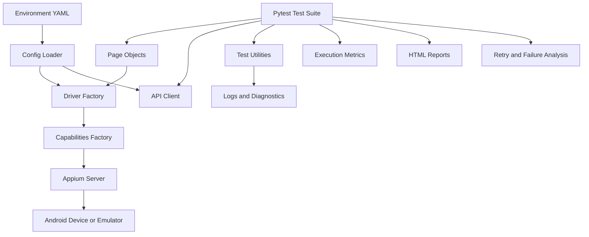

# Mobile Automation Framework

A Python-based mobile automation framework built with **Pytest, Appium, and Android**. This project demonstrates practical SDET engineering through mobile UI automation, API testing, reusable framework architecture, failure diagnostics, test execution analytics, and CI/CD integration.

The goal is to build a maintainable and diagnosable automation framework—not just a collection of test scripts.

## Key Features

- **Mobile UI Automation:** Automate Android application workflows using Appium and UiAutomator2.
- **Page Object Model:** Separate page interactions from test logic to improve maintainability.
- **Driver Factory:** Centralize driver creation and simplify driver lifecycle management.
- **Capabilities Factory:** Manage Android automation capabilities separately from test logic.
- **Environment-Based Configuration:** Load and validate environment-specific YAML configuration for local and QA environments.
- **API Testing:** Use a reusable API client for HTTP requests, API tests, and API/mobile workflows.
- **Reusable Utilities:** Common utilities for waits, gestures, test data, logging, and screenshots.
- **Failure Diagnostics:** Capture screenshots, UI page source, driver/device details, and test logs when tests fail.
- **Retry Analytics:** Track retry activity and distinguish recovered operations from exhausted retries.
- **Failure Classification:** Categorize failures to support debugging and root-cause analysis.
- **Flaky-Test Analysis:** Analyze test stability and identify tests that may require investigation.
- **Execution Insights:** Collect test execution metrics for improved visibility into test results.
- **Parallel Execution:** Use pytest-xdist for suitable tests while accounting for shared-emulator constraints.
- **HTML Reporting:** Generate reports with test results and diagnostic attachments.
- **Docker Support:** Build and run the framework in a container when the required services are available.
- **GitHub Actions:** Automate framework validation through CI workflows.

## Technology Stack

| Area | Technology |
|---|---|
| Programming Language | Python 3.12 |
| Test Framework | Pytest |
| Mobile Automation | Appium Python Client |
| Android Automation | UiAutomator2 |
| API Testing | Requests |
| Configuration | YAML / PyYAML |
| Parallel Execution | pytest-xdist |
| Test Reporting | pytest-html |
| Containerization | Docker / Docker Compose |
| CI/CD | GitHub Actions |
| Mobile Platform | Android |

## Architecture

The framework separates test cases, page objects, driver management, configuration, API access, and supporting utilities.



## Engineering Highlights

### 1. Reusable Automation Architecture

The framework separates test logic from supporting infrastructure through page objects, driver factories, capability management, and reusable utilities.

This structure helps reduce duplication and makes framework components easier to maintain and test.

### 2. Configuration and Environment Management

Environment-specific settings are maintained in YAML files:

- `config/local.yaml`
- `config/qa.yaml`

The configuration loader validates required settings and supports environment-variable overrides for the Appium server URL.

### 3. Mobile and API Testing

The framework combines Android UI automation with API testing.

Its components support API tests, integration tests, and API/mobile workflow scenarios.

### 4. Failure Diagnostics and Observability

When a test fails, the framework attempts to collect useful debugging information:

- Failure screenshots
- Android UI page source
- Driver and device diagnostics
- Captured test logs
- Failure details in the HTML report

These artifacts help engineers investigate failures without relying only on the final pass/fail result.

### 5. Retry and Test-Stability Analysis

The framework includes components for:

- Retry metrics
- Recovered and exhausted retry tracking
- Failure classification
- Flaky-test analysis
- Execution insights

These capabilities provide a foundation for investigating unstable tests and understanding test execution behavior.

### 6. Parallel Execution

The framework uses pytest-xdist to run suitable tests in parallel.

Tests that interact with a shared Android emulator require additional care because concurrent operations can interfere with each other. The execution strategy therefore needs to account for shared-device constraints.

### 7. Reporting and CI/CD

The framework supports HTML reports, execution metrics, Docker-based execution, and GitHub Actions-based validation.

Together, these capabilities help make test execution more repeatable and debugging information easier to access.

## Repository Structure

```text
mobile-automation-framework/
├── api/
│   └── api_client.py
├── config/
│   ├── config_loader.py
│   ├── local.yaml
│   └── qa.yaml
├── core/
│   ├── base_driver.py
│   ├── capabilities_factory.py
│   ├── driver_factory.py
│   ├── driver_manager.py
│   ├── exceptions.py
│   ├── execution_insights.py
│   ├── failure_classifier.py
│   └── flaky_test_analyzer.py
├── docs/
│   └── Implementation documentation
├── pages/
│   ├── base_page.py
│   └── settings_page.py
├── test_data/
│   └── login_data.yaml
├── tests/
│   ├── integration/
│   ├── unit/
│   └── Mobile and framework tests
├── utils/
│   ├── driver_diagnostics.py
│   ├── gesture_utils.py
│   ├── logger.py
│   ├── retry_metrics.py
│   ├── retry_utils.py
│   ├── screenshot.py
│   ├── test_data_loader.py
│   ├── test_metrics.py
│   └── wait_utils.py
├── .github/
│   └── workflows/
│       └── mobile-tests.yml
├── Dockerfile
├── docker-compose.yml
├── pytest.ini
├── pyproject.toml
├── requirements.txt
└── README.md
```

*The structure above highlights the main components; individual files may evolve as the framework develops.*

## Prerequisites

For local Android mobile testing, install and configure:

- Python 3.12
- Node.js and npm
- Appium Server
- Appium UiAutomator2 driver
- Android SDK and platform tools
- A compatible Android emulator or device
- ADB
- Git

Docker is optional for container-based execution.

## Setup

### 1. Clone the repository

```bash
git clone git@github.com:mkrishnavarun/mobile-automaton-framework.git
cd mobile-automaton-framework
```

Alternatively, use the HTTPS clone URL available on GitHub.

### 2. Create a Python virtual environment

```bash
python3.12 -m venv venv
source venv/bin/activate

python -m pip install --upgrade pip
pip install -r requirements.txt
```

### 3. Install Appium and UiAutomator2

Install an Appium version compatible with the framework and your environment.

For the version used during development:

```bash
npm install -g appium@3.7.0
appium driver install uiautomator2
```

Verify the installation:

```bash
appium --version
appium driver list --installed
adb devices
```

Ensure the Android SDK is configured and that ADB can detect your emulator or connected device.

### 4. Configure the environment

The framework provides two environment configuration files:

- `config/local.yaml`
- `config/qa.yaml`

Review the appropriate file and confirm that its Appium URL, Android device settings, application package/activity, and API base URL match your environment.

The configuration loader validates required configuration fields.

Select the environment using the `--env` option:

```bash
pytest --env local
pytest --env qa
```

The `APPIUM_SERVER_URL` environment variable can override the configured Appium server URL.

### 5. Start Appium and the Android device

Start Appium in a separate terminal:

```bash
appium
```

Start your Android emulator or connect a compatible device.

Verify device connectivity:

```bash
adb devices
```

Ensure that the Appium server and device are available before running mobile tests.

## Running Tests

Run the following commands from the repository root with your virtual environment activated.

### Run the Full Test Suite

```bash
pytest --env local
```

### Run Mobile Tests

```bash
pytest -m mobile --env local
```

Mobile tests require a compatible Android device or emulator and a reachable Appium server.

### Run Non-Mobile Tests in Parallel

```bash
pytest -m "not mobile" -n 2 --env local
```

Adjust the worker count according to your machine and test dependencies.

Avoid parallel execution of tests that share an emulator unless those tests are designed to run safely in parallel.

### Run API-Marked Tests

```bash
pytest -m api --env local
```

This command selects tests explicitly marked with `api`. Confirm that the intended tests carry this marker and that the selected environment is configured correctly.

### Generate an HTML Report

```bash
pytest --env local \
  --html=reports/html/report.html \
  --self-contained-html
```

After execution, open the generated HTML report in a browser.

### Specify a Test Metrics Output Path

The framework provides a `--metrics-output` option:

```bash
pytest --env local \
  --metrics-output=reports/metrics/test-results.json
```

The generated metrics and reporting artifacts depend on the tests executed and the framework's reporting hooks.

## Failure Diagnostics and Test Insights

Failure diagnostics are intended to make test failures easier to investigate.

When a test fails, the framework attempts to capture:

| Artifact | Purpose |
|---|---|
| Screenshot | Inspect the visible application state |
| UI page source | Examine the Android UI hierarchy |
| Driver/device details | Inspect relevant automation and device information |
| Test logs | Review captured log messages |
| HTML report | Review test results and available diagnostic attachments |

Additional components support retry metrics, failure classification, flaky-test analysis, and execution insights.

These features help provide context for test failures and support further root-cause investigation.

## Docker

Build the Docker image:

```bash
docker compose build
```

Run the configured Compose service:

```bash
docker compose up --abort-on-container-exit
```

The current Docker Compose configuration:

- Builds the test image from the project Dockerfile.
- Uses host networking.
- Sets the `APPIUM_SERVER_URL` environment variable.
- Runs `pytest --env local`.

**Important:** The Docker image does not provision an Android emulator or start an Appium server itself. Mobile tests running inside the container require a reachable Appium server and the necessary device connectivity and access.

Configure and validate those dependencies before relying on Docker for mobile test execution.

## Continuous Integration

The GitHub Actions workflow is located at:

`.github/workflows/mobile-tests.yml`

Consult the workflow file for the exact triggers, environment setup, Android/Appium installation, test execution, and reporting behavior.

The CI configuration is part of the framework's repeatability and automated-validation strategy.

## Current Scope

The mobile tests use Android Settings as the sample application.

This repository is a portfolio project demonstrating automation framework engineering practices. It is not presented as a production-ready, multi-device orchestration platform.

## Potential Future Improvements

Possible extensions include:

- Device-farm integration and multi-device scheduling
- Stronger test-data and environment isolation
- Additional quality gates for flaky tests and retry rates
- Expanded application workflows and API/UI scenarios
- Historical trend analysis for test stability and execution time

## Author

**SDET | QA Automation Engineering**

GitHub profile: [mkrishnavarun](https://github.com/mkrishnavarun)

Project repository: [Mobile Automation Framework](https://github.com/mkrishnavarun/mobile-automaton-framework)